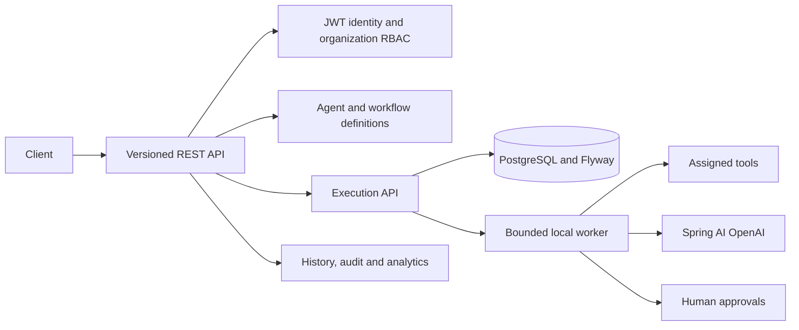
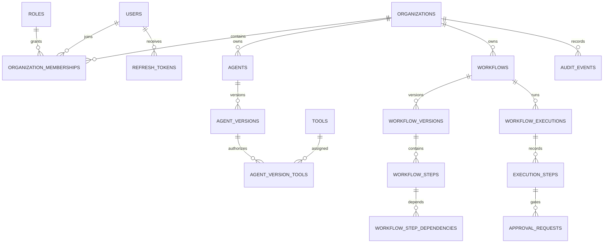
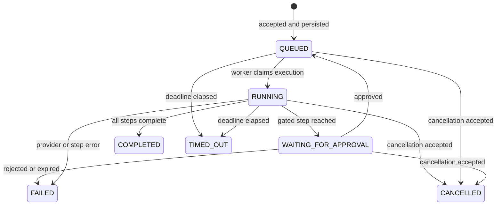

# AgentFlow

AgentFlow is an early-stage multi-tenant AI workflow orchestration MVP using Java 21, Spring Boot 3.4, PostgreSQL/Flyway, Spring Security/JWT, and Spring AI. Workflows execute asynchronously on a persistent PostgreSQL-backed local worker. Kafka is configured for future event-driven execution but is not currently the execution transport.

## Features currently implemented

- User registration, login, JWT access tokens, refresh-token rotation and logout.
- Per-IP throttling on register, login and refresh endpoints, plus per-account login lockout.
- Organization creation/listing, membership-based role checks and tenant-scoped queries.
- Agent drafts, versioned tool assignments, publish/pause/archive operations.
- Workflow definitions with DAG validation, immutable published versions and sequential/conditional steps.
- Persistent executions, retry attempts, idempotency keys, cancellation, step history and recovery handling.
- Calculator, date/time, structured extraction and organization-scoped document search tools; HTTPS HTTP API tool gated by explicit approval and host allowlist.
- Human approval queue, approve/reject decisions, audit events and token/cost analytics.
- Spring AI OpenAI integration with a manually controlled tool loop bounded by configured call and token budgets; configure credentials to invoke a real model.
- HTTP API tool requires a workflow approval and exact hostname allowlisting; DNS answers are checked and pinned to the request connection, redirects/retries are disabled, and request/response sizes are bounded.

This is an MVP, not a production-ready service. Local verification on 2026-10-31 confirmed source compilation and 14 passing tests (11 unit tests and 3 PostgreSQL/Redis Testcontainers integration tests). The live Compose stack had four healthy services; Flyway V1 and V2 were applied, the application health endpoint was UP, and REST checks exercised registration/login, organization and tenant isolation (cross-tenant access returned 404), refresh-token rotation/replay revocation, agent/tool configuration, calculator execution, a published multi-step workflow, persisted approval and resumption, execution history and idempotency. Two runtime defects found during earlier verification were fixed: a step-history query referenced a nonexistent timestamp column, and approval creation used the workflow definition step ID instead of the generated execution-step ID.

`mvn clean compile`, `mvn test` and the exact `mvn clean verify` command passed with 14 tests, zero failures/errors/skips. Maven Central DNS was unavailable inside the restricted verification sandbox; direct DNS/HTTPS and Maven resolution succeeded with network access. Testcontainers discovers Docker through the active `desktop-linux` endpoint after applying a test-scoped docker-java API 1.44 override (`src/test/resources/docker-java.properties`). The PostgreSQL/Redis integration tests applied both migrations and booted the Spring context. The source-based Docker image was built and the app container recreated from it; PostgreSQL, Redis, Kafka and the app were healthy, and `/actuator/health` returned `UP`. REST checks verified approval rejection, viewer write denial, invalid membership denial, persisted execution failure, pending approval survival across app restart and successful resumption, refresh-token replay revocation and tenant isolation. A real Spring AI request reached OpenAI and received 401 for a disposable invalid credential; this exposed and led to a fix for provider error key redaction. Provider-unavailable and agent-timeout failure tests also pass. No usable OpenAI key is configured, so successful model tool selection, tool-result round-trip and final answer remain unverified. Kafka is not currently used by the application execution path and is not started by the integration test. Do not treat this MVP as production-ready.

## Requirements

- JDK 21
- Maven 3.9+
- Docker Desktop with Compose v2 for the full stack and Testcontainers

## Start with Docker Compose

```powershell
Copy-Item .env.example .env
# Edit .env; set DB_PASSWORD, REDIS_PASSWORD, and a random JWT_SECRET of at least 32 bytes.
docker compose config --quiet
docker compose up --build -d
docker compose ps
Invoke-RestMethod http://localhost:8080/actuator/health
```

Health check: `http://localhost:8080/actuator/health`
OpenAPI UI: `http://localhost:8080/swagger-ui.html`

For host-based app startup, start the dependencies with `docker compose up -d postgres redis kafka`. Import `.env` into the current PowerShell process, then start Spring Boot:

```powershell
Get-Content .env | Where-Object { $_ -match '^\s*[^#][^=]*=' } | ForEach-Object {
  $name, $value = $_ -split '=', 2
  [Environment]::SetEnvironmentVariable($name.Trim(), $value.Trim(), 'Process')
}
mvn spring-boot:run
```

## Environment variables

| Variable | Required | Purpose |
|---|---:|---|
| `DB_NAME`, `DB_USERNAME`, `DB_PASSWORD` | yes | PostgreSQL database and credentials |
| `DB_URL` | no | JDBC URL; defaults to local PostgreSQL |
| `REDIS_PASSWORD` | compose | Redis authentication |
| `JWT_SECRET` | yes | HMAC signing secret, minimum 32 bytes |
| `KAFKA_BOOTSTRAP_SERVERS` | no | Kafka address; defaults to localhost:9092 |
| `AI_CHAT_MODEL` | no | Set to `openai` to enable Spring AI OpenAI auto-configuration; default `none` |
| `OPENAI_API_KEY` | for live AI | OpenAI credential; never commit it |
| `OPENAI_MODEL` | no | Provider model name; defaults to `gpt-4o-mini` |
| `AI_PROVIDER_TIMEOUT` | no | Per-request OpenAI client timeout; defaults to `30s` |
| `AI_PROVIDER_MAX_RETRIES` | no | OpenAI transport retries; defaults to `0` so agent deadlines govern retries |
| `HTTP_TOOL_ALLOWED_HOSTS` | for HTTP tool | Comma-separated exact hostnames; only HTTPS on port 443 is allowed |
| `AI_INPUT_USD_PER_1K_TOKENS`, `AI_OUTPUT_USD_PER_1K_TOKENS` | no | Cost estimates; defaults to zero |
| `DB_POOL_SIZE`, `REDIS_HOST`, `REDIS_PORT` | no | Runtime tuning |

For a host PowerShell session, load `.env` values manually or use a local environment manager. Compose reads `.env` automatically.

To enable provider integration, set `AI_CHAT_MODEL=openai`, provide a valid `OPENAI_API_KEY` in `.env`, and select a supported `OPENAI_MODEL`. Restart with `docker compose up --build -d app`. The key is passed as an environment variable and must not be put in source, workflow files, command history, or issue reports. Live provider behavior remains unverified until this is tested with a valid credential.

## Example API flow

Use the access token returned from login in `Authorization: Bearer <accessToken>`. Generate and retain refresh tokens securely; refresh tokens are rotated on each use.

```http
POST /api/v1/auth/register
Content-Type: application/json

{"email":"demo@example.com","password":"a-long-unique-password","fullName":"Demo User"}
```

```http
POST /api/v1/auth/login
Content-Type: application/json

{"email":"demo@example.com","password":"a-long-unique-password"}
```

```http
POST /api/v1/organizations
Authorization: Bearer <accessToken>
Content-Type: application/json

{"name":"Demo Organization"}
```

Create and publish an agent using the seeded calculator/date/time tool IDs `00000000-0000-0000-0000-000000000001` and `00000000-0000-0000-0000-000000000002`:

```http
POST /api/v1/organizations/{organizationId}/agents
Authorization: Bearer <accessToken>
Content-Type: application/json

{"name":"Demo assistant","description":"Uses calculator and clock","systemPrompt":"Answer clearly. Use available tools when useful.","provider":"openai","model":"gpt-4o-mini","temperature":0.2,"maxSteps":5,"maxTokenBudget":4000,"timeoutSeconds":60}
```

Assign tools with `PUT /api/v1/organizations/{organizationId}/agents/{agentId}/tools` and body `{"toolIds":["00000000-0000-0000-0000-000000000001","00000000-0000-0000-0000-000000000002"]}`, then publish with `POST /api/v1/organizations/{organizationId}/agents/{agentId}/publish`. Create and publish a workflow under `/api/v1/organizations/{organizationId}/workflows`, then execute:

```http
POST /api/v1/organizations/{organizationId}/workflows/{workflowId}/executions
Authorization: Bearer <accessToken>
Idempotency-Key: demo-run-001
Content-Type: application/json

{"input":{"task":"What time is it in UTC and what is 19 * 23?"}}
```

Poll `GET /api/v1/organizations/{organizationId}/executions` or `GET /api/v1/executions/{executionId}` and inspect `GET /api/v1/executions/{executionId}/steps`. Requests involving approval-required tools pause in `WAITING_FOR_APPROVAL`; an organization admin can inspect `GET /api/v1/organizations/{organizationId}/approvals` and POST to `/api/v1/approvals/{approvalId}/approve` or `/reject`. A local end-to-end tool workflow was exercised: calculator returned `437`, the UTC date/time tool ran, an approval request persisted, and approval resumed the execution to `COMPLETED`. A real AI/agent call was not exercised because no OpenAI API key was configured.

## Tests and verification

```powershell
mvn clean compile
mvn test
mvn clean verify
```

`FoundationIntegrationTest` uses Testcontainers and requires Docker. Docker Engine 29 rejects the older docker-java API default, so the test-only `docker-java.properties` pins API 1.44. `mvn clean verify` now passes against Docker Desktop 29.9.2. The integration suite starts PostgreSQL/pgvector and Redis, applies Flyway migrations, boots Spring, and checks token replay and tenant authorization. It does not start Kafka because Kafka is not yet used by application code. Flyway owns the schema; Hibernate is set to `validate`.

## Repository layout

- `src/main/java/com/agentflow`: identity, organization, agent, tool, workflow, execution, AI, approval, monitoring and shared infrastructure.
- `src/main/resources/db/migration`: PostgreSQL schema and built-in tool seed data.
- `docs/ARCHITECTURE.md`: architecture and trade-offs.
- `.github/workflows`: build CI.

## Architecture



### Database relationships



### Workflow execution lifecycle



The schema uses UUID primary keys, PostgreSQL JSONB for workflow/agent configuration and execution payloads, foreign keys for owned data, and pgvector for organization-scoped document chunks. Flyway owns schema changes; Hibernate validates rather than generating the schema. See [the architecture notes](docs/ARCHITECTURE.md) for trade-offs and known limitations.

## API endpoint map

All APIs are under `/api/v1`. Organization-specific routes check active membership and role before returning organization data.

| Area | Endpoints |
|---|---|
| Authentication | `POST /auth/register`, `/auth/login`, `/auth/refresh`, `/auth/logout` |
| Organizations | `POST /organizations`, `GET /organizations` |
| Agents | `GET/POST /organizations/{orgId}/agents`, `GET/PUT /organizations/{orgId}/agents/{agentId}`, `PUT .../{agentId}/tools`, `POST .../{agentId}/publish`, `POST .../{agentId}/pause`, `POST .../{agentId}/archive` |
| Tools | `GET /organizations/{orgId}/tools`, `POST /organizations/{orgId}/tools/{toolName}/execute` (non-approval tools only) |
| Workflows | `GET/POST /organizations/{orgId}/workflows`, `POST .../workflows/{workflowId}/publish` |
| Executions | `POST /organizations/{orgId}/workflows/{workflowId}/executions`, `GET /organizations/{orgId}/executions`, `GET /executions/{id}`, `GET /executions/{id}/steps`, `POST /executions/{id}/cancel` |
| Approvals | `GET /organizations/{orgId}/approvals`, `POST /approvals/{id}/approve`, `POST /approvals/{id}/reject`, `GET /executions/{id}/approvals` |
| Monitoring | `GET /organizations/{orgId}/analytics`, `GET /organizations/{orgId}/audit-logs` |

## Example workflow definition

Authenticate with `POST /api/v1/auth/login` and send its `accessToken` as `Authorization: Bearer <token>`. Create an organization with `{"name":"Demo Organization"}`. Create an OpenAI agent, assign the seeded `calculator` and `date_time` tool IDs, then publish the new agent version before creating a workflow:

```json
{
  "name": "Time and arithmetic",
  "description": "Ask an agent to use the calculator and clock tools",
  "triggerType": "MANUAL",
  "timeoutSeconds": 300,
  "inputSchema": {},
  "outputMapping": {},
  "steps": [
    {
      "key": "answer",
      "type": "AGENT",
      "agentVersionId": "<published-agent-version-uuid>",
      "config": {"task":"What is 19 * 23 and the current UTC time?"},
      "dependsOn": [],
      "timeoutSeconds": 120,
      "retryMaxAttempts": 1,
      "requiresApproval": false
    },
    {
      "key": "review",
      "type": "APPROVAL",
      "config": {},
      "dependsOn": ["answer"],
      "timeoutSeconds": 120,
      "retryMaxAttempts": 1,
      "requiresApproval": true
    }
  ]
}
```

Publish the returned workflow ID, then start it with `POST /api/v1/organizations/{orgId}/workflows/{workflowId}/executions`, an `Idempotency-Key` header, and body `{"input":{"task":"Use the assigned tools"}}`. Poll the execution and step history endpoints. The local run verified a tool-based workflow with a human approval step. The agent/OpenAI scenario is documented but needs a valid `OPENAI_API_KEY` for a live provider verification.

## Screenshots

Screenshots are not available yet; add API/Swagger and execution-history screenshots after a verified local run.

## License

AgentFlow is licensed under the [MIT License](LICENSE).

## GitHub publication

Review the full diff and `git status`, ensure `.env` and generated artifacts are excluded, then commit and push from a configured Git repository. This workspace snapshot currently has no `.git` metadata, so Git-based publication commands cannot run here. After creating a repository on GitHub, initialize Git only if this checkout still has no `.git` directory, add the repository as a remote, commit the reviewed files, and push to the selected branch. No repository was created, initialized, or pushed by this task.
