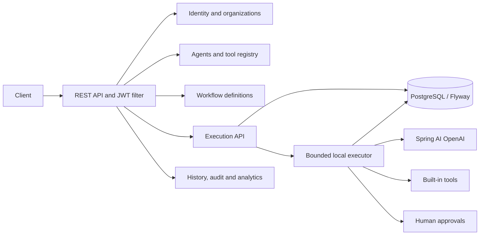
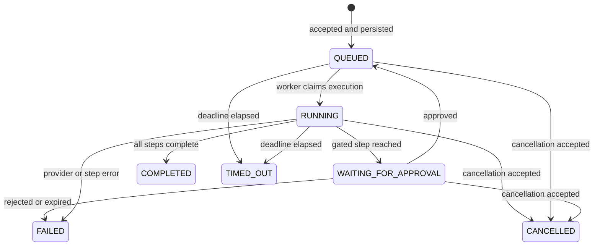

# AgentFlow — Architecture (current MVP)

## Current implementation status (2026-10-31)

The repository contains working initial implementations for identity (registration/login, BCrypt, JWT, rotated opaque refresh tokens), organization membership authorization, agent version/lifecycle APIs, built-in tools, workflow definition and publishing, a PostgreSQL-backed local execution runner, approvals, monitoring, and Spring AI OpenAI invocation. Execution jobs are stored in PostgreSQL and queued after commit; Kafka is configured but not the execution transport. Redis is configured but not yet used by application features.

Automated tests include a Testcontainers PostgreSQL/Redis Spring context and Flyway integration test with refresh-token replay and tenant-role checks, plus Docker-independent tests for AI-provider unavailability/failure/timeout, authentication throttling, redaction, calculator arithmetic, date/time behavior, and SSRF address classification. `mvn clean verify` passes with 14 tests on Docker Desktop 29.9.2. The test classpath pins docker-java API 1.44 because Docker Engine 29 rejects its older default API version. A local Compose run also verified migrations, health, registration/login, a persisted calculator/date-time workflow, approval/resumption, idempotency, tenant isolation and refresh replay. A real invalid-credential call reached OpenAI and returned 401. No usable key was configured, so successful model tool selection and response generation remain unverified. Treat this as an MVP under active development, not production-ready software.

## Architecture and trade-offs

| Area | Current choice | Trade-off / limitation |
|---|---|---|
| Deployment | Spring Boot modular monolith | Straightforward local deployment; package boundaries are not yet independently deployable modules. |
| Tenant isolation | Shared PostgreSQL schema, organization-scoped queries and membership role checks | Service-layer isolation depends on all future queries preserving organization predicates; PostgreSQL RLS and cross-tenant tests are future hardening. |
| Async execution | Local bounded executor, PostgreSQL as durable queue/state | Jobs survive restart as `QUEUED` rows and are swept back into execution. Interrupted `RUNNING` executions fail instead of replaying side effects. Expired approvals fail their waiting execution. This recovery model is for a single app instance; Kafka/distributed leases remain future work. |
| Idempotency | Unique `(organization_id, idempotency_key)` index plus transaction-scoped PostgreSQL advisory lock; conflicting reused request rejected | PostgreSQL-specific; only workflow starts using an idempotency key take the lock. |
| Recovery | Scheduled sweep requeues queued work, expires deadlines and marks stale running work failed | External side effects cannot be exactly-once; recovery deliberately avoids blindly replaying stale running steps. |
| Refresh tokens | Random opaque token, SHA-256 hash at rest, rotation and family revocation on replay | Access-token revocation waits for its short expiry. |
| Access tokens | Short-lived HMAC JWT with signature, issuer, expiry, issued-at, and access-token-purpose checks | Shared secret is simpler than asymmetric keys; production key rotation/JWKS is not implemented. |
| Credential throttling | Per-process fixed-window limits by remote socket IP for register, login, and refresh, plus database account lockout | Not shared across instances and does not trust forwarded-IP headers. Apply ingress-level limits when deployed behind a proxy or across replicas. |
| LLM | Spring AI OpenAI, manually controlled tool loop, single-call responses and aggregate tool/token budgets | Real provider behavior still needs a configured API key. Spring AI provider timeout and bounded retry settings should be kept aligned with the agent deadline; a synchronous tool callback may overrun it before control returns. |
| HTTP tool | Exact hostname allowlist, HTTPS/443 only, DNS answers checked and pinned into Apache HttpClient's resolver, private/special-use IP rejection, redirects/retries disabled, bounded request/response sizes, approval gate | This is defense in depth, not a substitute for network egress controls. Some special-purpose IP ranges may need additional deployment-specific deny rules. |
| Storage | Flyway SQL migrations; Hibernate schema validation | Migrations were applied by the PostgreSQL/pgvector Testcontainers test and the live Compose database. |

## Component flow

## Package layout

`identity`, `organization`, `agent`, `tool`, `workflow`, `execution`, `ai`, `approval`, and `monitoring` contain the initial API and service implementations. `shared` contains configuration, security, and web error/correlation handling. `audit`, `usage`, and `notification` do not yet provide complete standalone modules.

## Workflow lifecycle

## Important verification gaps

- Exercise the complete agent-to-OpenAI tool-calling flow with a valid key; provider invalid-credential, outage, timeout and token-limit behavior remains unverified against the live service.
- Add integration coverage for agent/workflow APIs, execution retries/cancellation/recovery, approval expiry and decision races, and tool-call audit capture. Current Testcontainers coverage does not start Kafka; Kafka is not yet used by application code.
- Add deployment-level egress controls for HTTP API tools and review the IPv4/IPv6 special-use deny list against the exact deployment network before production use.
- Replace process-local rate limiting and single-instance recovery before horizontal scaling; add key rotation/JWKS and centralized secret storage for production deployments.
